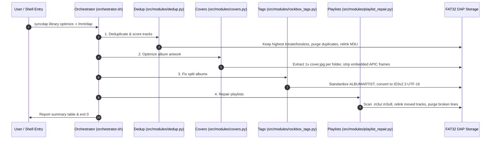

# Architecture Overview

`syncdap` implements a strict two-tier architecture: **POSIX Shell Coordinators** for environment management, signal handling, and argument routing, combined with **Python Processing Engines** for media analysis, metadata parsing, and API integration.

```text
                                  User Invocations (CLI)
                                            │
                                            ▼
                                   syncdap (Entrypoint)
                                            │
        ┌───────────────────────────────────┴───────────────────────────────────┐
        ▼                                                                       ▼
CLI Grammar & Parsing (src/sh/cli.sh)                 Configuration & State (src/sh/config.sh)
        │
        ▼
Orchestration Coordinator (src/sh/orchestrator.sh)
        │
        ├───────────────────────────────────┬───────────────────────────────────┐
        ▼                                   ▼                                   ▼
External Ingestion / Rescues        Dedicated Domain Engines           Metadata & Hardware Engines
(spotDL / yt-dlp / ffmpeg)          (Patch / Playlists / Romaji)       (Rockbox Tags / Covers / Lyrics)
        │                                   │                                   │
        └───────────────────────────────────┼───────────────────────────────────┘
                                            ▼
                             Underlying File System / DAP Mount
                                   (/mnt/dap or ./Music)
```

---

## 1. Two-Tier Execution Model & Boundaries

### The Shell Coordinator Tier (`src/sh/`)
- **Strict Boundary:** Shell scripts handle process lifecycle, interactive terminal formatting, dependency discovery, POSIX argument parsing, and temp directory lifecycles. They **never** directly parse ID3/Vorbis/MP4 binary frames or manipulate complex JSON trees.
- **Process Isolation & Signal Traps:** Every execution registers cleanup handlers:
  ```bash
  trap cleanup EXIT INT TERM
  ```
  This guarantees that interrupted background tasks or failed downloads never leave dangling lockfiles, temporary files (`$TEMP_DIR/search_resolved.json`), or corrupted partial streams.
- **Dual-Audience Messaging:** All interactive indicators, ANSI colors, Nerd Font glyphs, and human progress counters are routed strictly to `stderr`. Only pure data (e.g. `--json` payloads, `--plain` TSV records, or resolved paths) is emitted to `stdout`.

### The Python Processing Tier (`src/modules/` & Domain Packages)
- **High-Performance Inspection:** Built upon `mutagen` for low-level audio tag inspection and writing, with `eyed3` and `pykakasi` where specialized transliteration or legacy ID3 manipulation is required.
- **Pure Processing Subsystems:** Modules like `src/modules/audit.py` or `src/share/text.py` operate on pure strings, filesystem paths, and parsed dictionaries. Network I/O is isolated inside `src/share/api.py`, `src/share/lyrics.py`, and `src/scrobbler/client.py`.
- **DAP Invariant Enforcement:** Python modules enforce strict hardware constraints before any byte is written to disk: stripping embedded artwork over 500 KB, standardizing `ALBUMARTIST`, converting to ID3v2.3 UTF-16, and truncating paths to prevent FAT32 errors.

---

## 2. Directory Layout & Boundaries

```text
src/
├── entry.py              # CLI Python dispatcher for standalone execution
├── sh/                   # POSIX Bash orchestration scripts
│   ├── main.sh           # Master script entrypoint, trap setup, and argument delegation
│   ├── cli.sh            # Entity-first grammar parser and --help generator
│   ├── orchestrator.sh   # Subcommand execution router (library, artist, album, track)
│   ├── downloader.sh     # spotDL execution with bitrate and error capture
│   ├── playlists.sh      # M3U8 normalization, DAP path remapping, and UTF-8 enforcement
│   ├── common.sh         # Dependency verification, runner wrappers (run_py, run_spotdl)
│   ├── icons.sh          # Terminal capability detection and monochromatic glyphs
│   └── config.sh         # Configuration reader/writer (~/.config/syncdap/config)
│
├── modules/              # Dedicated processing engines
│   ├── stats.py          # Audio format, bitrate, and library health analytics
│   ├── audit.py          # Duration auditing (>600s) to detect full-album rips
│   ├── album_expander.py # Unbundling single-file album rips into canonical tracks
│   ├── covers.py         # Standalone cover.jpg extraction and embedded APIC removal
│   ├── dedup.py          # Deduplication prioritizing lossless quality + playlist relinking
│   ├── fallback.py       # Multi-candidate yt-dlp search and stream rescue
│   ├── genres.py         # Multi-provider genre resolution (iTunes -> Deezer -> MusicBrainz)
│   ├── lyrics.py         # LRCLIB synchronized .lrc retrieval and embedding
│   ├── playlist_repair.py# Fuzzy Levenshtein relinking of broken playlist tracks
│   ├── rockbox_tags.py   # Split-album prevention (ALBUMARTIST) and filename cleanup
│   └── search.py         # Metadata resolution CLI helper
│
├── patch/                # Audio format transcoding and quality upgrade pipeline
│   ├── cli.py            # Patch CLI interface
│   ├── metadata.py       # Tag preservation during transcode
│   ├── playlist.py       # Playlist reference updates after patch
│   └── worker.py         # Multithreaded transcoding workers
│
├── playlists/            # Interactive playlist management and maintenance
│   ├── actions.py        # Playlist mutation actions (merge, dedup, prune, reorder)
│   ├── cli.py            # Playlist CLI grammar parser
│   ├── core.py           # M3U/M3U8 parsing and path resolution
│   ├── manager.py        # Playlist library scanning and cache
│   └── ui.py             # Terminal UI components for playlist inspection
│
├── romaji/               # Japanese tag transliteration (Kanji/Kana -> Latin Romaji)
│   ├── cli.py            # Romaji CLI interface
│   ├── engine.py         # Transliteration coordinator for tags, lyrics, and files
│   ├── lyrics.py         # LRC synchronized lyric line transliteration
│   ├── playlist.py       # M3U8 path updating for transliterated files
│   ├── tags.py           # Mutagen audio tag transliteration
│   └── translit.py       # pykakasi wrapper with Hepburn Romanization rules
│
├── scrobbler/            # Rockbox .scrobbler.log synchronization with Last.fm
│   ├── auth.py           # Last.fm Desktop Web Authentication flow
│   ├── cli.py            # Scrobbler CLI interface
│   ├── client.py         # Last.fm API client with MD5 request signing
│   ├── parser.py         # Audioscrobbler log parser with timezone heuristics
│   └── state.py          # Atomic watermark state persistence
│
└── share/                # Shared utilities across all Python engines
    ├── api.py            # HTTP clients for iTunes, Deezer, and MusicBrainz
    ├── audio.py          # Universal Mutagen tag reader/writer (FLAC, MP3, M4A, OGG)
    ├── config.py         # Python configuration loader and XDG path resolution
    ├── constants.py      # Audio extensions, ignored directories, and regex patterns
    ├── covers.py         # Artwork detection and APIC extraction helpers
    ├── icons.py          # Monochromatic glyphs and formatted terminal logging
    ├── lyrics.py         # LRCLIB API client and syncedlyrics wrapper
    ├── playlists.py      # Playlist path resolution and parsing
    └── text.py           # FAT32 string sanitization and character mapping
```

---

## 3. Data Flow: Full Optimization Pipeline (`syncdap library optimize`)

When executing `syncdap library optimize -r /mnt/dap`, the coordinator executes five coordinated stages to transform an unorganized directory into a Rockbox-compliant music store:



### Pipeline Failure & Recovery Semantics
1. **Partial Transcode / Download Failure:** Download engines write to temporary filenames (`*.part`, `$TEMP_DIR/*`). Only after full verification (audio integrity check via `ffprobe`/`mutagen`) is the file atomically moved to its destination folder.
2. **Crash Resilience:** If power or USB connection drops during optimization, each file operation is atomic (`write -> fsync -> rename`). The deduplication engine verifies track existence prior to purging, ensuring no data loss on read-only or disconnected mounts.
3. **Rollback & Dry Run:** All optimization engines support `-n` / `--dry-run`, enabling non-destructive preview of file deletions, tag changes, and artwork extractions.
